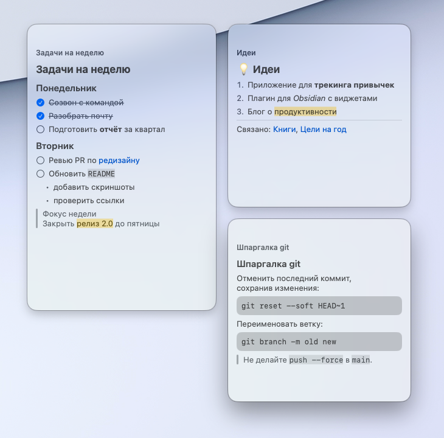
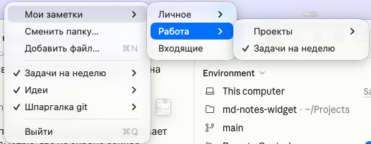

# MD Widgets

Нативное macOS-приложение, которое показывает заметки Obsidian (`.md`) как полупрозрачные виджеты на рабочем столе.

*A tiny native macOS app that pins Obsidian Markdown notes to your desktop as translucent, draggable widgets.*



## Возможности

- **Виджеты на рабочем столе.** Лежат над иконками, но под обычными окнами, и видны на всех рабочих столах (Spaces).
- **Свободная раскладка.** Виджет перетаскивается за полосу с названием и меняет размер за края. Положение запоминается.
- **Полупрозрачный фон** с размытием, как у системных панелей, следует светлой или тёмной теме.
- **Markdown:** заголовки, **жирный**, *курсив*, `код`, `==выделение==`, ссылки, `[[вики-ссылки|алиас]]` (открывают Obsidian), списки и вложенные списки, чекбоксы, цитаты и callout, блоки кода, горизонтальные линии. Блок свойств (frontmatter) скрывается.
- **Живое обновление.** Изменения, сделанные в Obsidian, появляются в виджете в течение пары секунд.
- **Дерево заметок.** Выберите папку хранилища, и её заметки появятся в меню деревом. Клик показывает или скрывает виджет.

## Требования

- macOS 14 Sonoma или новее.
- Swift 5.9+: хватит Xcode Command Line Tools (`xcode-select --install`), полный Xcode не нужен.

## Сборка

```bash
git clone git@github.com:utb404/md-notes-widget.git
cd md-notes-widget
./build.sh
open "MD Widgets.app"
```

`build.sh` собирает релизную версию, прогоняет self-test парсера Markdown и упаковывает `MD Widgets.app` с ad-hoc подписью. Приложение можно перенести в «Программы».

## Использование

Всё управление идёт через иконку заметки в строке меню (в Dock приложения нет):

- **Выбрать папку заметок…** — указать хранилище Obsidian. В меню появится его дерево: клик по заметке показывает или скрывает её виджет.
- **Добавить файл…** — добавить отдельный `.md`-файл из любого места.
- **Список виджетов** — у каждого: показать/скрыть, открыть в Obsidian, удалить.



Правый клик по виджету: «Открыть в Obsidian» и «Скрыть».

Для автозапуска добавьте приложение в «Системные настройки → Основные → Объекты входа».

## Ограничения

- Не поддерживаются таблицы и картинки (картинки показываются именем файла).
- Редактировать заметку в виджете нельзя, только смотреть.
- Ссылки `[[…]]` открываются в последнем открытом хранилище Obsidian.

## Устройство

| Файл | Что внутри |
|------|-----------|
| `Sources/MDWidgets/main.swift` | Окна-виджеты (`NSPanel` + `NSVisualEffectView`), меню, дерево папки, сохранение настроек |
| `Sources/MDWidgets/Markdown.swift` | Разбор Markdown по строкам и отрисовка в SwiftUI, self-test (`--selftest`) |
| `build.sh` | Сборка и упаковка `.app` |

## Лицензия

[MIT](LICENSE)
